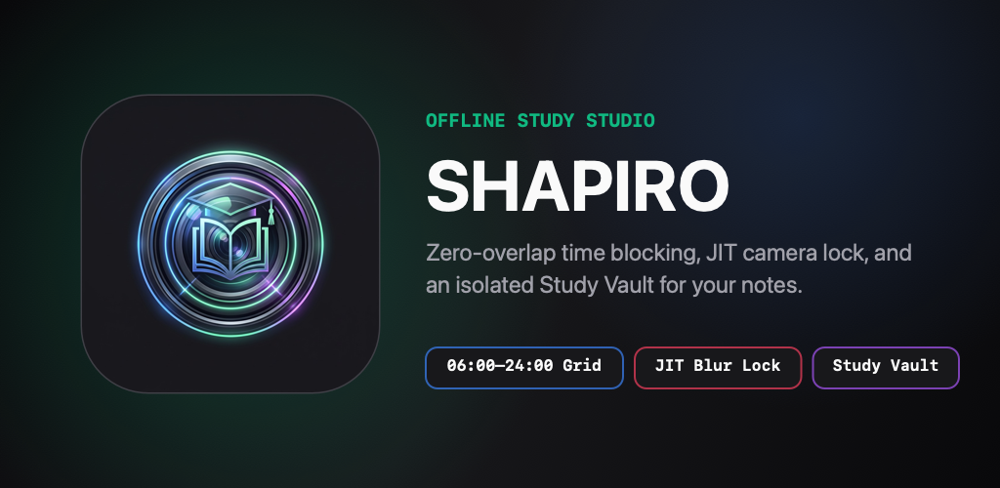
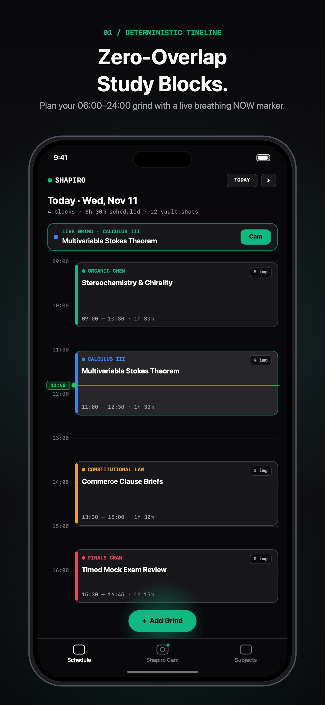
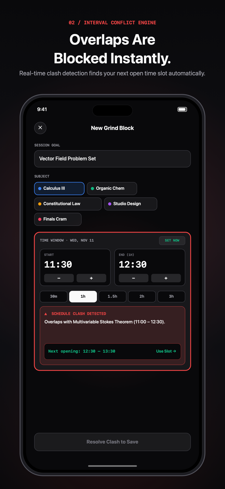
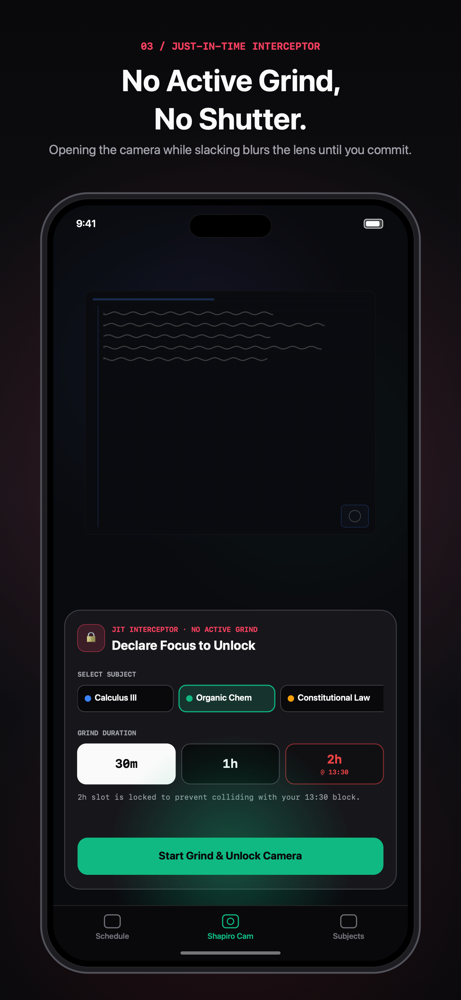
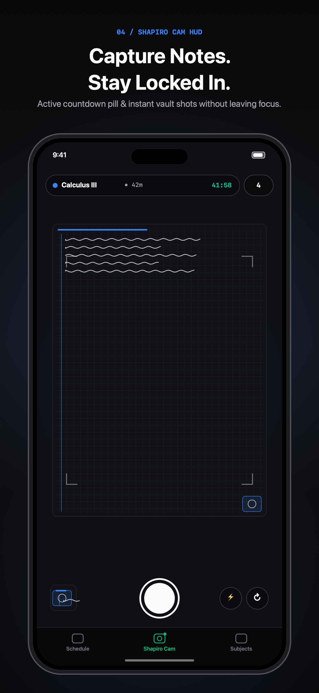
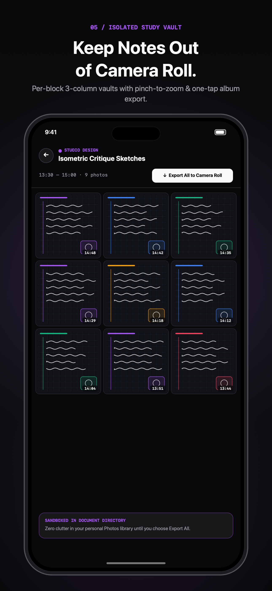

# Shapiro

<p align="center">
  
</p>

**Shapiro** is an offline-first, local-first study studio for iOS (built with **Expo SDK 58**, **TypeScript**, **Expo Router**, **NativeWind v4**, **Reanimated 4**, **Zustand**, and **SQLite**). It enforces deterministic, zero-overlap time blocking and keeps whiteboard/note captures isolated inside per-session **Study Vaults**—never cluttering your personal Camera Roll unless you explicitly export them.

---

## Core Philosophy & Features

1. **Deterministic Zero-Overlap Schedule (`06:00–24:00`)**
   - Interactive day timeline rendered at `1.2 dp/min` with auto-scroll to current time and a breathing `NOW` indicator updating every 60 seconds.
   - Strict interval clash detection ($\max(S_1, S_2) < \min(E_1, E_2)$) enforced both in real-time UI validation and inside SQLite transactions.
   - Automatic gap finder (`findNextAvailableSlot`) that highlights conflicts in `#EF4444`, fires error haptics, and offers a one-tap jump to the next open slot.

2. **Shapiro Cam & Just-in-Time (JIT) Interceptor**
   - Opening the camera outside an active study block blurs the viewfinder (`BlurView`) and locks capture behind a non-dismissible JIT Focus Sheet.
   - Select a subject and a collision-checked duration (`30m`, `1h`, `2h`) to unlock the viewfinder in `150ms`.
   - Includes a live countdown glass pill, flying thumbnail animation on shutter press, `500 MB` minimum free-disk-space safeguard, mid-session expiry prompt (*Extend 30m or wrap up?*), and an automatic sample-note fallback when running on iOS Simulator without physical camera hardware.

3. **Isolated Study Vault & Bulk Export**
   - Photos are saved atomically inside `Paths.document/vault/{subject_id}/{block_id}_{id}.jpg` (never written to the system Photos library automatically).
   - 3-column gallery per study block with full-screen pinch-to-zoom, pan, double-tap reset (`react-native-gesture-handler`), and one-tap **Export All to Camera Roll** into `"Shapiro - {Subject Name}"` albums.

4. **Subject Manager & Studio Controls**
   - Create, edit, and delete subjects across `STEM`, `Bio`, `Humanities`, `Arts`, and `Cram` categories with custom palette tokens and aggregated block/photo/hour stats.

---

## App Store Screenshots

| Schedule Timeline | Clash Engine | JIT Interceptor | Shapiro Cam HUD | Study Vault |
| :---: | :---: | :---: | :---: | :---: |
|  |  |  |  |  |

---

## Tech Stack

- **Runtime:** Expo SDK `~58.0.23`, React `19.3.0`, React Native `0.88.1`, TypeScript `~6.0.3`
- **Navigation:** `expo-router` (`~58.0.30`) with typed routes (`(onboarding)`, `(tabs)`, `modal/add-grind`, `vault/[blockId]`)
- **Styling:** `nativewind` (`^4.2.7`) + `tailwindcss` (`^3.4.19`)
- **State:** `zustand` (`^5.1.0`) + `@react-native-async-storage/async-storage`
- **Persistence & Storage:** `expo-sqlite` (`shapiro.db` with `PRAGMA foreign_keys = ON` & WAL mode), `expo-file-system` (`Paths`, `File`, `Directory`)
- **Media & Device:** `expo-camera`, `expo-media-library`, `expo-blur`, `expo-haptics`, `expo-device`
- **Animations & Gestures:** `react-native-reanimated` (`4.7.1`), `react-native-gesture-handler` (`~3.3.0`)
- **Package Manager:** `pnpm` (`nodeLinker: hoisted` configured in `pnpm-workspace.yaml`)

---

## Architecture & Database Schema

```
┌────────────────────────────────────────────────────────┐
│            UI Layer (Expo Router + NativeWind)         │
│    Reanimated 4 + Gesture Handler + Lucide Icons       │
└──────────────────────────┬─────────────────────────────┘
                           │
┌──────────────────────────▼─────────────────────────────┐
│             Domain & Session State (Zustand)           │
│     useSessionStore + Deterministic Conflict Engine    │
└──────────────────────────┬─────────────────────────────┘
                           │
┌──────────────────────────▼─────────────────────────────┐
│           Local Persistence & Vault Storage            │
│  • expo-sqlite (shapiro.db: subjects, blocks, photos)  │
│  • expo-file-system (Paths.document/vault/{subjectId}) │
│  • AsyncStorage (onboarding state)                     │
└────────────────────────────────────────────────────────┘
```

### SQLite Tables (`src/db/database.ts`)

- **`subjects`**: `id`, `name`, `color`, `category` (`STEM | Bio | Humanities | Arts | Cram`), `created_at`
- **`study_blocks`**: `id`, `subject_id` (FK cascade), `title`, `start_time`, `end_time`, `created_at` + index `idx_study_blocks_time(start_time, end_time)`
- **`vault_photos`**: `id`, `study_block_id` (FK cascade), `file_path`, `captured_at`, `file_size_bytes` + index `idx_vault_photos_block(study_block_id)`

All timestamps are stored as **UNIX Epoch milliseconds** (`INTEGER`) for deterministic range queries.

---

## Project Structure

```
shapiro/
├── app.json                           # Expo config, iOS permissions, splash (#18181B) & icon
├── babel.config.js                    # Babel preset with NativeWind JSX import source
├── metro.config.js                    # Metro wrapped with withNativeWind
├── tailwind.config.js                 # Design tokens (surface, brand, subject, status)
├── pnpm-workspace.yaml                # nodeLinker: hoisted for Metro/RN compatibility
├── assets/images/                     # App icon, splash icon, favicon
├── store-assets/                      # App Store screenshots (1290x2796), icon & banners
└── src/
    ├── app/
    │   ├── _layout.tsx                # Root Stack, DB init, SafeAreaProvider, onboarding gate
    │   ├── (onboarding)/index.tsx     # Screen 01: 4-slide Reanimated onboarding carousel
    │   ├── (tabs)/
    │   │   ├── _layout.tsx            # Bottom tabs (Schedule, Shapiro Cam, Subjects)
    │   │   ├── index.tsx              # Screen 02: 06:00–24:00 timeline & breathing NOW bar
    │   │   ├── camera/index.tsx       # Screen 04/05: Shapiro Cam HUD & JIT Interceptor
    │   │   └── subjects/index.tsx     # Subject Manager & local vault stats
    │   ├── modal/add-grind.tsx        # Screen 03: Add/Edit Grind modal with clash engine
    │   └── vault/[blockId].tsx        # Screen 06: 3-column Study Vault, zoom modal & export
    ├── db/database.ts                 # SQLite schema, default seed & conflict-safe CRUD
    ├── stores/useSessionStore.ts      # Active block state, countdown tick & onboarding flag
    ├── types/domain.ts                # Core TypeScript domain types & subject palette
    └── utils/
        ├── id.ts                      # Unique ID generator
        ├── schedule.ts                # Overlap detector, gap finder & timeline math
        └── vaultStorage.ts            # Sandboxed file vault, 500MB guard & MediaLibrary export
```

---

## Getting Started (with `pnpm`)

### Prerequisites

- **Node.js** 20+
- **pnpm** (`corepack enable` or standalone `pnpm`)
- **Xcode** & **iOS Simulator** (macOS)

### Installation & Running

```bash
# 1. Install dependencies
pnpm install

# 2. Launch on iOS Simulator
pnpm ios

# Or start Expo Dev Server
pnpm start
```

### Verification Commands

```bash
# TypeScript type-check
pnpm exec tsc --noEmit

# Export production iOS Hermes bundle
pnpm exec expo export --platform ios
```

### Native iOS Build (Prebuild)

If you are building a standalone or development client instead of Expo Go:

```bash
pnpm exec expo prebuild --clean
pnpm exec expo run:ios
```

---

## License

MIT — see [LICENSE](./LICENSE).
